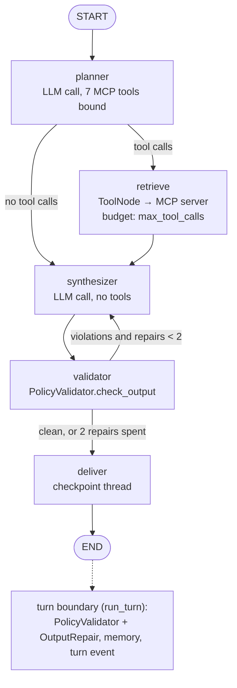

# consilium-health

> **Not medical advice.** This is an educational software project. It does not diagnose, treat, or
> provide clinical guidance, and it must not be used for real medical decisions. No patient data of
> any kind may be used with it.

## Overview

Consilium Health answers health-information questions by retrieving from a 78-note educational
corpus, running one of two orchestrations over seven skills (a planner–worker–synthesizer router,
or a LangGraph graph over the same skills served through the project's MCP server), and passing
every answer through a policy validator and a deterministic repair before delivery. Every turn
writes a structured trace, and every number in this document is computed from committed traces by
the evaluation harness, never typed in. It is not a clinical tool, not a medical device, and not a
system that has been validated on real patients; its headline measured result is a safety
regression that is documented rather than fixed.

## Architecture

Both orchestrators sit behind one interface, `consilium.runtime.Orchestrator`, inside one turn
boundary, `consilium.runtime.run_turn`. The boundary assesses the question against the red-flag
table, calls the orchestrator, runs `PolicyValidator` and `OutputRepair` on what comes back,
updates working memory and writes the `turn` event. `ORCHESTRATOR=legacy|langgraph` selects the
orchestrator per process; the CLI, the HTTP API and the evaluation harness all go through
`run_turn`, so a measured difference between the two is a difference in the orchestrator only.

```
Interfaces     consilium/cli.py · consilium/api/ · consilium/mcp_server.py · python -m consilium.graph
Turn boundary  consilium/runtime.py        red-flag assessment · validator · repair · memory · trace
Orchestrators  consilium/router/ (legacy)  ·  consilium/graph/ (langgraph)  ·  consilium/adk/ (adk)
Skills         consilium/skills/           7 skills, one registry, one schema per skill
Substrate      retrieval · memory · safety · llm · trace · config · log
```

**Legacy (`consilium/router/`, the measured baseline).** A planner LLM call returns a JSON plan
naming one to three specialists (`consultation`, `diagnostic`, `research`); an unusable plan falls
back to `consultation` and is counted. Specialists run concurrently under a 90-second shared
deadline, each as a ReAct loop (`consilium/agents/loop.py`) over the skills `data/policy.yaml`
permits it, with `max_tool_calls=2` and `max_iterations=3` enforced in code. A synthesizer merges
two or more completed answers under fixed precedence (diagnostic wins on urgency, consultation on
facts, research on evidence strength); a single completed answer is delivered without a merge.

**LangGraph (`consilium/graph/`).** One `StateGraph` with five nodes. `planner` is one model call
with the seven MCP tools bound; it chooses tools, not specialists. `retrieve` is
`langgraph.prebuilt.ToolNode`; the tools execute inside `consilium/mcp_server.py` (in-process over
the MCP SDK's memory streams by default, or a `consilium mcp-serve` stdio child, or a streamable-HTTP
URL — `CONSILIUM_GRAPH_MCP`), and the `max_tool_calls` budget is enforced inside the tools, as the
legacy loop enforces it. `synthesizer` writes the answer from the tool observations. `validator`
runs the same `PolicyValidator` the turn boundary uses; on a violation the edge returns to
`synthesizer` with a repair instruction built from `data/policy.yaml`'s own rule text, at most
`CONSILIUM_GRAPH_MAX_REPAIRS` (default 2) times. `deliver` strips the turn's scratch messages and
checkpoints the thread in a `MemorySaver` keyed by `thread_id = session_id`. Model calls go through
`consilium.llm.LLMProvider` behind a `BaseChatModel` adapter, so they are `llm_call` trace events
with the same caller labels and model ids as the legacy run.



There is a third orchestrator, `ORCHESTRATOR=adk` (`consilium/adk/`): the legacy architecture as
Google ADK agents on Vertex AI Gemini. It is complete and tested offline and has no evaluation run;
`docs/gcp-migration-STATUS.md` is its status note. It is not discussed further here.

Differences that affect how the two measured orchestrators compare: the graph emits no `route`
event (routing accuracy is not applicable to it); the graph's planner may call any of the seven
tools, whereas each legacy specialist is restricted to its permitted skills; each MCP tool result
reaches the graph's synthesizer inside the server's safety envelope (disclaimer appended, banner
prepended for a red-flag input), which the legacy loop's observations do not carry.

## Usage patterns

All commands run from the repository root. `uv sync` installs the core dependencies and dev tools;
`uv sync --extra embeddings` adds `sentence-transformers` and `chromadb`, which the real retrieval
pipeline needs and CI does not install. Provider configuration lives in `.env` (see
`.env.example`); `CONSILIUM_PROVIDER=mock` runs every path with no key and no network.

```bash
# Index the corpus (once; real pipeline, downloads bge-small-en-v1.5)
uv run consilium ingest
# Offline variant of the same pipeline, no download, no persistence
uv run consilium ingest --embedder hash --store numpy
```

**CLI**

```bash
uv run consilium ask "What does guidance say about starting a statin?"          # legacy
ORCHESTRATOR=langgraph uv run consilium ask "What does guidance say about starting a statin?"
uv run consilium chat                                   # multi-turn REPL, one session id
uv run consilium trace <session_id> --turn 0            # read a trace
uv run consilium runs purge --session <session_id> --yes   # delete traces
```

**HTTP**

```bash
uv run uvicorn consilium.api.main:app                   # http://127.0.0.1:8000
ORCHESTRATOR=langgraph uv run uvicorn consilium.api.main:app
curl -s http://127.0.0.1:8000/healthz                   # reports provider, model, orchestrator
curl -s -X POST http://127.0.0.1:8000/v1/ask -H 'content-type: application/json' \
     -d '{"question": "What is the ICD-10 code for type 2 diabetes?"}'
curl -N -X POST http://127.0.0.1:8000/v1/chat -H 'content-type: application/json' \
     -d '{"question": "I have had a headache and a stiff neck since this morning."}'   # SSE
curl -s http://127.0.0.1:8000/v1/sessions/<session_id>   # turn count and compaction state only
```

`POST /v1/ask` and `/v1/chat` take `{"question": str, "session_id": str | null}`; omit the session
id to start a conversation. `GET /` serves a single-file demo page.

**MCP, stdio** (for a desktop host; no provider key is needed, the host brings its own model)

```bash
uv run consilium mcp-serve                              # stdio; logs go to stderr
```

```json
{"mcpServers": {"consilium-health": {"command": "uv", "args": ["run", "consilium", "mcp-serve"],
                                      "cwd": "/path/to/consilium-health"}}}
```

**MCP, streamable HTTP**

```bash
uv run consilium mcp-serve --transport http --host 127.0.0.1 --port 8001 --path /mcp
```

Seven tools are published (`search_knowledge`, `assess_risk`, `analyze_symptoms`,
`recommend_lifestyle`, `lookup_disease_code`, `find_guideline`, `deep_research`), each with the
registry's own `inputSchema`; every result is wrapped by the output policy and traced as a
`tool_call` with `transport: "mcp"`.

**LangGraph entry point**

```bash
ORCHESTRATOR=langgraph uv run python -m consilium.graph "What are the red-flag symptoms for sepsis?"
uv run python -m consilium.graph --mock "What are the red-flag symptoms for sepsis?"   # offline
CONSILIUM_GRAPH_MCP=stdio CONSILIUM_GRAPH_MCP_ARGS="--embedder hash --store numpy" \
    uv run python -m consilium.graph --mock "What are the red-flag symptoms for sepsis?"
```

The command runs one turn through `run_turn`, prints the answer, the safety outcome and the trace
file, then lists the trace's events (`llm_call` per node, `tool_call`/`retrieval` per MCP call,
`turn`). LangSmith tracing is on when `LANGSMITH_TRACING=true` and `LANGSMITH_API_KEY` are set
(`LANGSMITH_PROJECT` defaults to `consilium-health`); with the flag set and no key it is switched
off with one log line.

**Evaluation**

```bash
uv run python -m eval.run --config full --max-cost 3.00                      # legacy
ORCHESTRATOR=langgraph uv run python -m eval.run --config full --max-cost 3.00
uv run python -m eval.graph_compare eval/results/<stamp>                    # comparison table
uv run python -m eval.publish --from eval/results/<stamp> --out eval/results/published-langgraph
```

## Evaluation results

**The LangGraph run has not been executed.** The implementation was written and tested in an
environment with no route to `api.openai.com`; the harness refuses the mock provider, correctly. The
legacy columns are the published run (2026-08-30, commit `f19584a`, `gpt-4o-mini` as agent and
judge, 150 golden items per row); the LangGraph column will be filled by the runbook in
`docs/LANGGRAPH_EVAL.md`, which prints this table with that column populated. No LangGraph number
appears anywhere in this repository until then.

| metric | `baseline_llm` (legacy) | `single_agent_rag` (legacy) | `full` (legacy) | `full_no_memory` (legacy) | `full` (`ORCHESTRATOR=langgraph`) |
|---|---|---|---|---|---|
| retrieval recall@5 (union; n=149 labelled) | n/a | 0.721 | 0.857 | 0.885 | not run |
| faithfulness, retrieved sources (judge mean) | n/a | 0.828 | 0.737 | 0.763 | not run |
| faithfulness, oracle sources (judge mean) | 0.630 | 0.765 | 0.713 | 0.715 | not run |
| red-flag recall, post-repair (n=28) | 0.893 | 0.929 | 0.500 | 0.536 | not run |
| output violations / repairs per 100 turns | 102.7 / 102.7 | 104.0 / 104.0 | 104.0 / 104.0 | 103.3 / 103.3 | not run |
| routing accuracy / planner fallback | n/a | n/a | 0.867 / 0.000 | 0.853 / 0.000 | n/a (no `route` event) |
| latency p50 / p90 / p95 | 1.27 / 1.74 / 1.84 s | 2.53 / 3.34 / 3.50 s | 3.98 / 7.37 / 7.74 s | 4.19 / 7.14 / 8.39 s | not run |
| cost per turn / per 150-item run | $0.00013 / $0.019 | $0.00057 / $0.085 | $0.00120 / $0.181 | $0.00123 / $0.185 | not run |
| tokens / LLM calls / tool calls per turn | 514 / 1.00 / 0.00 | 3219 / 1.83 / 1.08 | 6714 / 3.71 / 1.71 | 6892 / 3.72 / 1.73 | not run |

Raw data: `eval/results/published/` (`summary.json`, `report.md`, 679 session traces,
`MANIFEST.json` with sha256 digests; `python -m eval.publish --verify` recomputes them). The
LangGraph run will be published to `eval/results/published-langgraph/` in the same layout. p50 and
p90 are harness outputs; p95 is `eval.metrics.percentile` over the same `turn.wall_ms` values,
computed by `eval/graph_compare.py`. Cost is the sum of traced `llm_call` tokens at
`eval/pricing.yaml` rates ($0.15 / $0.60 per million tokens for `gpt-4o-mini`); the judge's calls
are not traced and are not included.

Two caveats carry over from `docs/EVALUATION.md`. `relevant_doc_ids` (144 of 150 items) and
`reference_answer` (148 of 150) were written by a model and not verified by a person, so recall@5
and both faithfulness rows are measured against a machine-constructed reference; routing accuracy
and red-flag recall are hand-labelled. The faithfulness judge's agreement with a blind human sample
is Cohen's kappa = 0.592 (n=40), below the 0.6 line, with residual disagreement in the direction of
the judge being too loose.

The headline result of the published run is negative: the `full` configuration retrieves better
than single-agent RAG (recall@5 0.857 against 0.721) and delivers a seek-care instruction on half
the red-flag items (0.500 against 0.893 for a plain LLM). The mechanism is in `docs/SAFETY.md` §7
and in the Limitations below.

## Limitations

- **Red-flag recall in `full` is 0.500.** When `assess_risk` finds no pattern match it returns a
  non-match, and the diagnostic agent restates it as a finding; the model that escalates unaided
  stops doing so. `g-su-001` (twenty-minute crushing chest pain) is answered "There is no emergency
  pattern based on the symptoms you've described" — `eval/results/published/traces/full-g-su-001.json`,
  against `traces/baseline_llm-g-su-001.json`, which escalates. 13 of the 14 misses are in the
  hard-phrasing stratum.
- **The input-side red-flag matcher is a literal phrase table.** It matched 5 of 5 plainly-phrased
  red-flag items and 0 of 22 realistically-phrased ones; the escalation banner can only be forced
  for what it matches. Across 650 turns it rescued one answer.
- **A routing error can make the right document unreachable.** `g-gh-017`: a diet question routed
  to `research`, whose `find_guideline` is filtered to `guideline`, so the one relevant `lifestyle`
  note cannot be returned at any rank (`traces/full-g-gh-017.json`; the single-agent run retrieved
  it at rank 1).
- **A correctly routed turn can answer from parametric memory.** `g-cc-017`: no `tool_call` and
  no `retrieval` event, two relevant notes unretrieved, a blind human label of `unsupported`
  (`traces/full-g-cc-017.json`). Three other items do the same.
- **An answer can contradict its own top-ranked source.** `g-ge-024`: the right note at rank 1,
  and the answer says the medications are "not mentioned" when the note names three
  (`traces/full-g-ge-024.json`).
- **ICD-10 coverage is narrow.** Seven of the sixteen conditions in the corpus have a note that
  decides a code; the rest are covered by chapter maps only (`docs/CORPUS.md`).
- **The LangGraph orchestrator is unmeasured** (see Evaluation results). Known structural
  differences: no per-specialist skill policy (the planner may call all seven tools), no
  `max_iterations` guard (one planning step), thread memory is uncompacted (the legacy working
  memory replays the last five exchanges and compacts the rest), and the checkpointed answer is
  the pre-repair draft. The repair rounds are logged and visible in LangSmith but are not trace
  events.
- **`langchain-mcp-adapters` is not used.** Every release pins `mcp<2.0` and imports modules
  removed in mcp 2.x; the MCP server is written against mcp ≥2.1. `consilium/graph/mcp_tools.py`
  replaces it with an adapter on the mcp 2.x client (~100 lines). Over a remote HTTP server the
  graph cannot read the server's trace files, so retrieval events are absent from the turn trace and
  recall@5 is unmeasurable in that mode.
- **No authentication on the HTTP API or the MCP server.** `GET /v1/sessions/{id}` returns
  metadata only; `mcp-serve --transport http` binds to localhost by default. Not hardened.
- **`POST /v1/chat` streams the banner early and the body late.** The body is assembled and then
  delivered incrementally, so time to first token is the turn's latency (`docs/DESIGN.md`, Phase 9).
- **Cloud Run deployment is unverified.** `Dockerfile` and `deploy/cloudrun/*.sh` exist; the first
  Cloud Build has not been run and the ADK orchestrator has not been evaluated
  (`docs/gcp-migration-STATUS.md`).

## Guardrails

Two objects, one policy file, applied at the turn boundary on every orchestrator and to every MCP
result.

**What `PolicyValidator` enforces** (`data/policy.yaml`, `consilium/safety/validator.py`):

- Output scope, per sentence, four forbidden rules matched by regular expression:
  `dosing_instruction` (`500 mg`, `take 2`, `twice daily`, …), `definitive_diagnosis`
  (`you definitely have`, `your diagnosis is`, …), `prescription_advice` (`you should stop`,
  `double your dose`, …), `false_reassurance` (`nothing to worry about`, `no need to see a
  doctor`, …).
- Output scope, `escalation_required`: if the *question* matched the red-flag table
  (`data/red_flags.yaml`, literal phrases with a negation guard), the answer must contain an explicit
  seek-care instruction as `consilium/safety/escalation.py` defines it (a verb plus a place or a
  service; conditional phrasing does not count).
- Output scope, `disclaimer`: the fixed disclaimer text, matched after whitespace normalization.
- Tool-call scope, `unpermitted_skill`: a legacy specialist calling a skill its policy does not
  grant is refused and the refusal is traced.

**How repair works** (`consilium/safety/repair.py`), in fixed order: forbidden sentences are
replaced by a marker naming the rule (never rephrased); the escalation banner is prepended when
required and absent; the disclaimer is appended. Every detection is a `safety{event=violation}`
trace event and every fix a `safety{event=repair}` event; the two are reported as two rates. The
`turn` event records escalation presence before and after repair, which is how red-flag recall
(post-repair) and "model escalated unaided" (pre-repair) are both measured.

**The LangGraph repair loop.** Inside the graph the same validator runs on each draft, untraced;
on a violation the synthesizer is re-run with an instruction quoting the violated rules'
descriptions and, for the disclaimer, the exact required text. Maximum two rounds
(`CONSILIUM_GRAPH_MAX_REPAIRS`). Whatever is left is handed to the boundary, where the
deterministic repair runs and is traced exactly as on the legacy path. The loop therefore changes
the violation and repair *rates*; it cannot change what is guaranteed about the delivered text.

**What the guardrails do not do.** They do not detect an emergency the phrase table does not
match (the measured gap above). They do not check facts: a sentence can contradict its source and
pass. The sentence splitter is a punctuation split, so a redaction can take one clause too many.
The escalation detector is strict by design, so an unusually phrased escalation is counted as a
miss and repaired with a second banner. The MCP server's envelope guards each tool result, not the
host's final answer. Nothing here is a clinical safety system.

## Platform comparison: self-hosted hybrid retrieval vs Snowflake Cortex Search

Measured 2026-10-01 (`eval/cortex/`, results in `eval/cortex/results/2026-10-02/`). Protocol: the
same 149 labelled golden questions, the same 78-note corpus and the same chunker (312 chunks,
800–1,000 characters, loaded into Snowflake byte-identical); the raw question as the query, no
category filter, 20 chunks requested, deduplicated to documents in rank order, first 5 scored for
recall@5 and hit@5, first 10 for MRR@10; `eval.metrics` functions imported, not reimplemented.

| retriever | recall@5 | hit@5 | MRR@10 | p90 latency |
|---|---|---|---|---|
| self-hosted hybrid, BM25 + bge-small-en-v1.5, RRF k=60 (direct replay) | 0.918 | 0.946 | 0.833 | 7.5 ms (in-process) |
| Cortex Search, arctic-embed-m-v1.5 | 0.950 | 0.973 | 0.932 | 241 ms (REST, laptop → AWS us-east-2) |
| Cortex Search, arctic-embed-l-v2.0 | 0.957 | 0.987 | 0.927 | 240 ms |

The published 0.721 is the same self-hosted retriever measured *inside* `single_agent_rag` agent
turns (model-rewritten queries, category-filtered skills); 0.918 is the like-for-like number. With
the project's offline `HashEmbedder` the replay scores 0.756. Cost of the Cortex experiment: 0.27
credits of warehouse time and 0.005 credits of AI functions on an XSMALL warehouse (about $1 at
list price); `CORTEX_SEARCH` serving was not yet metered.

When to choose which: the self-hosted hybrid is the right default when the corpus is small and
static, latency matters (single-digit milliseconds in process), and there is no Snowflake account —
it also keeps the BM25 exact-token behaviour that `lookup_disease_code` depends on for strings like
`E11.9`. Cortex Search is the better retriever by 3–4 points of recall@5 and about 10 points of
MRR@10 on this corpus, with no model to host, and is the right choice when the data already lives
in Snowflake, when governance has to be in one place, or when the corpus will grow past what a
laptop index serves well; it costs a network round trip per query and warehouse credits per
refresh. Neither result transfers to a different corpus without rerunning the replay.

## Handoff guidance

**Environment variables** (`consilium/config.py`, `.env.example`):

| variable | default | meaning |
|---|---|---|
| `CONSILIUM_PROVIDER` | `mock` | `openai`, `anthropic` or `mock` |
| `CONSILIUM_MODEL` | provider default | model id; the published run used `gpt-4o-mini` |
| `OPENAI_API_KEY` / `ANTHROPIC_API_KEY` | — | only the selected provider's key is needed |
| `ORCHESTRATOR` | `legacy` | `legacy`, `langgraph` or `adk` |
| `CONSILIUM_GRAPH_MCP` | `inprocess` | `inprocess`, `stdio`, or an `http(s)://…/mcp` URL |
| `CONSILIUM_GRAPH_MCP_ARGS` | empty | extra `consilium mcp-serve` arguments for the stdio child |
| `CONSILIUM_GRAPH_MAX_REPAIRS` | `2` | validator → synthesizer rounds |
| `CONSILIUM_ADK_MODEL` | `gemini-2.5-flash` | ADK only |
| `CONSILIUM_RUNS_DIR` | `runs` | where traces are written |
| `CONSILIUM_DATA_DIR` / `CONSILIUM_CORPUS_DIR` / `CONSILIUM_CHROMA_DIR` / `CONSILIUM_EPISODIC_DB` | `data`, `data/corpus`, `data/chroma`, `data/episodic.db` | data locations |
| `CONSILIUM_LOG_LEVEL` / `CONSILIUM_LOG_FORMAT` | `INFO` / `json` | structlog |
| `LANGSMITH_TRACING` / `LANGSMITH_API_KEY` / `LANGSMITH_PROJECT` | off / — / `consilium-health` | LangSmith, LangGraph path only |

**Data sources.** `data/corpus/` — 78 markdown notes in five categories (19 coding, 16 condition,
19 guideline, 13 lifestyle, 11 red-flag), written for this project, with no clinical authority;
`docs/CORPUS.md` is the contract. `data/policy.yaml` (agents, permitted skills, output rules),
`data/red_flags.yaml` (the escalation phrase table), `data/symptom_systems.yaml` (body-system
grouping). `eval/data/golden.jsonl` (150 items; `expected_route` and `red_flag` hand-labelled,
`relevant_doc_ids` and `reference_answer` machine-written and unverified), `eval/data/multiturn.jsonl`
(29 conversations), `eval/judges/*.md` (judge prompts; `faithfulness_v2` is the one in use),
`eval/pricing.yaml` (list prices with dates). The Chroma index under `data/chroma/` is gitignored
and rebuilt by `consilium ingest`.

**Re-running the evaluation.** `docs/LANGGRAPH_EVAL.md` has the step-by-step runbook. In short:
`uv sync --extra embeddings`, `uv run consilium ingest`, set the provider and key in `.env`, then
`ORCHESTRATOR=<legacy|langgraph> uv run python -m eval.run --config full --max-cost 3.00`. The run
writes `eval/results/<stamp>/{summary.json, report.md, runs/}`; `python -m eval.graph_compare
eval/results/<stamp>` prints the comparison and per-item deltas with trace paths;
`python -m eval.publish --from eval/results/<stamp> --out eval/results/published-langgraph`
copies it into the committed layout with a manifest. The sweep is sequential (latency is a reported
number); the harness refuses the mock provider and refuses a spend cap for an unpriced model.
Expect under $1 at `gpt-4o-mini` list prices for one configuration plus the judge.

**Adding a tool.** Write a module under `consilium/skills/` that defines a pydantic argument model
and a function decorated with `@skill(name=..., description=..., category=...,
requires_retrieval=...)` taking `args: <Model>` and `ctx: SkillContext` and returning
`SkillResult.success(name, payload, sources=...)` (see `consilium/skills/coding.py`).
`SkillRegistry.discover()` imports every module in the package, so there is no list to edit. Grant
the skill to the agents that may use it in `data/policy.yaml` (`permitted_skills`); an unknown name
there fails at agent construction. The MCP server, the legacy loop's OpenAI tool definitions and
the LangGraph planner's bound tools all derive their schema from the same
`Skill.parameters_schema()`, so nothing else changes. Note that `eval/validate.py` derives
*exclusive* skill grants from `policy.yaml` to check the golden set's route labels: a skill granted
to every agent is non-exclusive and drops out of that check. Add a contract test in
`tests/test_mcp_server.py` only if the new skill needs behaviour the schema round-trip does not
cover.

**Tests and checks.** `uv run pytest` (offline by default: `-m "not network"`; mock provider,
hash embedder, numpy store, in-process MCP), `uv run ruff check .`, `uv run ruff format --check .`,
`uv run mypy` (strict). `tests/test_graph_orchestrator.py` covers the LangGraph path;
`tests/test_eval_publish.py` verifies the published manifest.

**Deployment.** `Dockerfile` bakes the bge-small model and the Chroma index into the image;
`docker compose up --build` serves on port 8080. `deploy/cloudrun/bootstrap.sh` and `deploy.sh`
target Google Cloud Run and have not been run end to end; `deploy/aws/` is the earlier ECS Fargate
path, kept for reference. The orchestrator is chosen per deployment with `ORCHESTRATOR`.

**Traces.** `runs/<session_id>/<turn_index>.jsonl`, one JSON object per line, schema version 2
(`consilium/trace.py`). Traces contain verbatim questions and prompts; `consilium runs purge`
deletes them. Session ids in evaluation runs are `<config>-<item_id>`.

## Next steps

None of the following is done. Each item that changes measured behaviour needs its own evaluation
run before any number in this document is updated.

- **Run the LangGraph evaluation** and fill the column above; classify any regression against
  `full` by reading the trace pairs `eval/graph_compare.py` names.
- **Databricks mirror** of the corpus, index and evaluation harness — not started.
- **Banking corpus**: a second domain to test whether the orchestration, the policy mechanism and
  the harness transfer; the red-flag table and the output rules are domain-specific and would need
  equivalents — not started.
- **Snowflake Cortex AI functions**: `SNOWFLAKE.CORTEX.COMPLETE` as an alternate synthesizer,
  selectable by configuration, on the Cortex Search retriever already measured — not started; no
  Snowflake connection is configured in this repository.
- **Safety roadmap (v0.2)**, from `docs/SAFETY.md` §10: treat `assess_risk`'s non-match as "no
  pattern matched" rather than "no emergency" in the diagnostic prompt; a model-based escalation
  check beside the phrase table; fuzzy matching on red-flag patterns guarded by the false-positive
  probes; a DVT note and rule for `g-md-027`.
- **ADK orchestrator evaluation** on Vertex AI Gemini, and the first Cloud Run build.
- **Working-memory compaction for the LangGraph thread**, and recording the delivered (post-repair)
  answer in the checkpoint rather than the draft.

## Documentation

`docs/DESIGN.md` (decisions and rejected alternatives), `docs/EVALUATION.md` (golden set,
metrics, judge validation), `docs/SAFETY.md` (rule table, validator, repair, §7 on the red-flag
regression), `docs/FAILURE_CASES.md` (four traced failures), `docs/LANGGRAPH_EVAL.md` (LangGraph
evaluation status and runbook), `docs/CORPUS.md`, `docs/gcp-migration-STATUS.md`, `eval/cortex/README.md`
(the Cortex Search comparison), `CHANGELOG.md`.

## License

Apache 2.0. See `LICENSE`.
